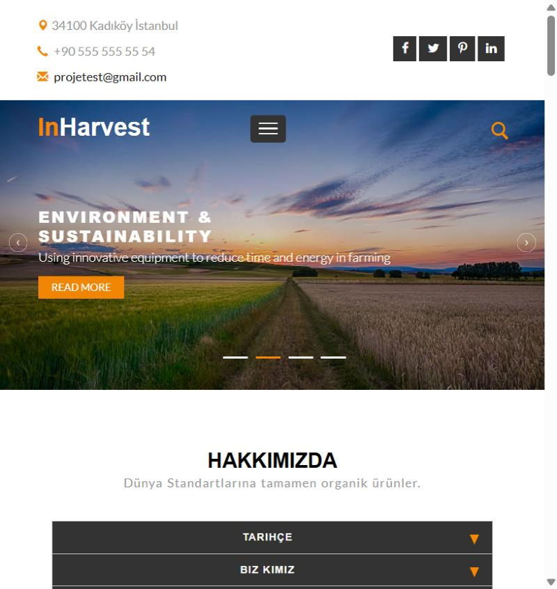
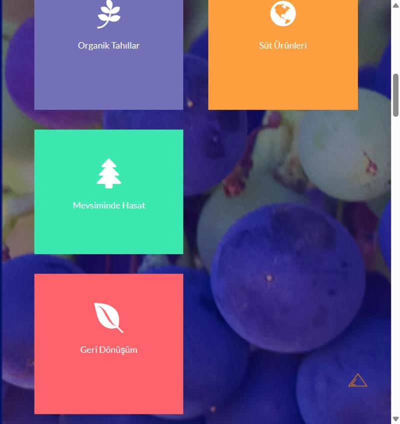
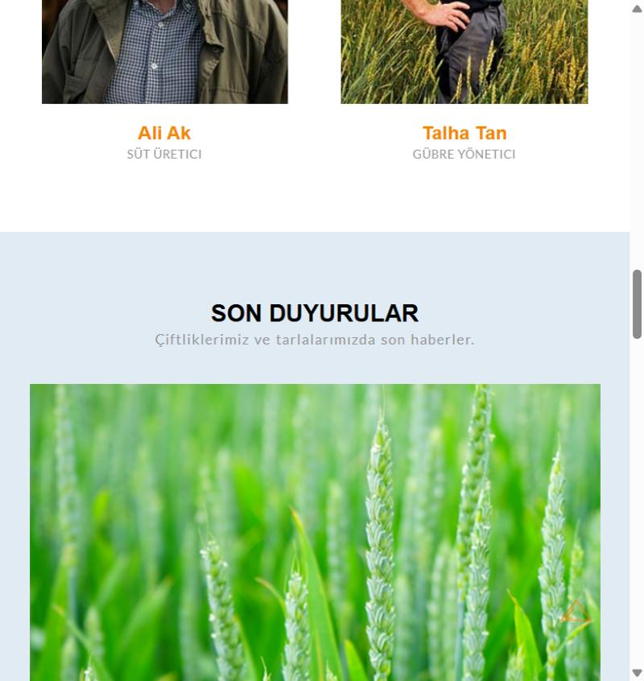
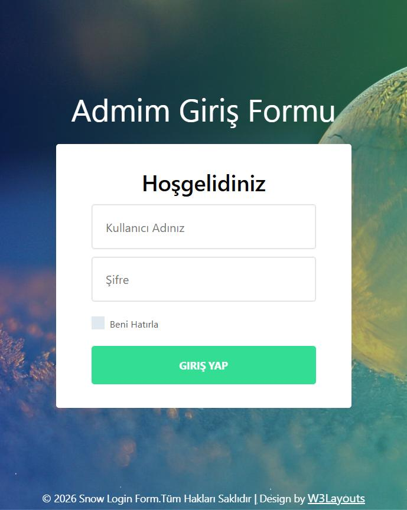

# 🌾 AgriculturePresentation

Tarım temalı bir kurumsal tanıtım sitesi. ASP.NET Core MVC ile geliştirilmiş, duyuru/hizmet/ekip gibi içerikleri yönetebileceğiniz bir **Admin Panel** içerir.

## ✨ Özellikler

- Katmanlı mimari: **EntityLayer / DataAccessLayer / BusinessLayer / Presentation**
- Generic repository pattern ile Entity Framework Core veri erişimi
- ViewComponent tabanlı anasayfa (Hakkımızda, Hizmetler, Ekip, Duyurular, Sosyal Medya vb. bölümler)
- Admin alanı (Area) üzerinden içerik yönetimi:
  - Duyuru (Announcement) yönetimi
  - Hizmet (Service) yönetimi
  - Ekip (Team) yönetimi
  - İletişim / Adres yönetimi
  - Görsel (Image) yönetimi
  - Dashboard ve raporlama (Excel export — ClosedXML / EPPlus)
  - Giriş ekranı (Identity ile kimlik doğrulama)

## 📸 Ekran Görüntüleri

**Anasayfa**


**Hizmetler**


**Ekip & Son Duyurular**


**Admin Giriş**


## 🛠️ Kullanılan Teknolojiler

- ASP.NET Core MVC (.NET 10)
- Entity Framework Core (SQL Server)
- ASP.NET Core Identity
- FluentValidation
- ClosedXML & EPPlus (Excel raporlama)
- Bootstrap tabanlı admin template

## 📁 Proje Yapısı

```
AgriculturePresentation/
├── AgriculturePresentation/   # Sunum katmanı (Controllers, Views, Areas/Admin, wwwroot)
├── BusinessLayer/             # İş kuralları ve servisler
├── DataAccessLayer/           # EF Core, generic repository, DbContext
└── EntityLayer/               # Entity sınıfları (Announcement, Service, Team, Contact, Address, Image, SocialMedia...)
```

## 🚀 Kurulum

1. Depoyu klonlayın:
   ```bash
   git clone https://github.com/mucahit1253/AgriculturePresentation.git
   ```
2. `appsettings.json` içindeki connection string'i kendi SQL Server bilgilerinize göre düzenleyin.
3. Migration'ları uygulayın:
   ```bash
   dotnet ef database update --project DataAccessLayer --startup-project AgriculturePresentation
   ```
4. Projeyi çalıştırın:
   ```bash
   dotnet run --project AgriculturePresentation
   ```

## 📄 Lisans

Bu proje kişisel/eğitim amaçlı geliştirilmiştir.
